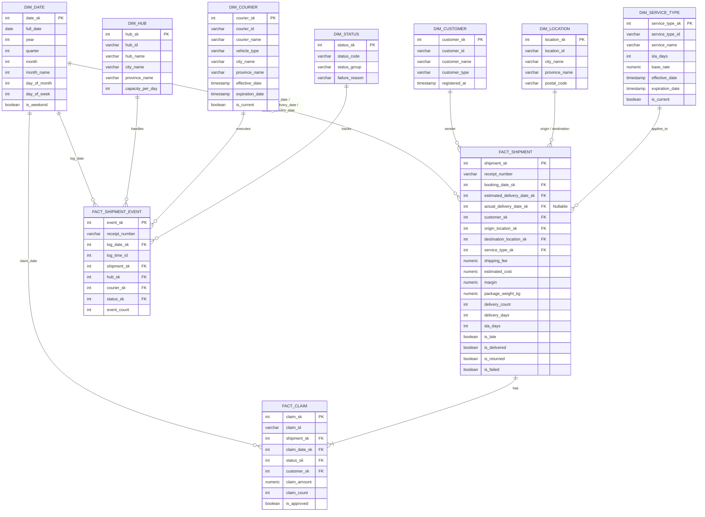

# Skema Database Warehouse (OLAP) - Sistem Logistik & Pengiriman Barang

Dokumen ini mendefinisikan desain Data Warehouse (OLAP) untuk analisis operasional ekspedisi logistik, dibangun di atas PostgreSQL. Skema dirancang sesuai metodologi Kimball 4 langkah (business process → grain → dimension → facts) dan informasi sumber berdasarkan `oltp.md` serta kebutuhan pemangku kepentingan di `Project.md`. Tiga business process menghasilkan tiga fact table (galaxy / fact constellation) yang berbagi conformed dimensions.

---

## 1. Business Process & Fact Table (Kimball Step 1–2)

| Proses Bisnis | Stakeholder | Fact Table | Grain | Tujuan Analisis |
|---|---|---|---|---|
| Pemantauan Performa Pengiriman | COO / VP Logistics | `fact_shipment` | 1 baris = 1 resi (SHIPMENT) | On-Time Delivery Rate, durasi pengiriman, tren delay per provinsi & layanan |
| Operasional Hub & Kurir | Head of Branch & Hub Operations | `fact_shipment_event` | 1 baris = 1 event status log (SHIPMENT_STATUS_LOG) | Throughput paket per hub, rasio gagal kirim, produktivitas kurir |
| Analisis Pendapatan, Biaya & Klaim | Finance & Commercial Manager | `fact_shipment` + `fact_claim` | 1 resi / 1 klaim (CLAIM) | Revenue (shipping_fee), biaya (estimated_cost), margin, statistik klaim |

**Keputusan desain penting:**

1. `SHIPMENT` tidak memiliki FK langsung ke `COURIER` — hubungan hanya melalui `SHIPMENT_STATUS_LOG`. Oleh karena itu `fact_shipment` **tidak memuat dimensi kurir**; produktivitas kurir dijawab oleh `fact_shipment_event`.
2. `SHIPMENT_STATUS_LOG.hub_id` dan `courier_id` nullable → tidak boleh ada FK null di OLAP. Buat baris pengganti "No Hub" (`hub_sk = -1`) dan "No Courier" (`courier_sk = -1`).
3. Metrik turunan (`delivery_days`, `is_late`, `is_delivered`) **dihitung saat ETL di staging**, bukan saat query.
4. `fact_claim` mengeksponasikan `claim_id` sebagai **degenerate dimension** (tidak perlu dim_claim terpisah).
5. PII operasional (`recipient_name`, `recipient_phone`, `recipient_address`) tidak dibawa ke OLAP — jangkauan analisis hanya sampai kota/provinsi tujuan.

---

## 2. Entity Relationship Diagram (ERD)

---

## 3. Information Package (Kimball Step 3–4)

### A. Fact: `fact_shipment` — Performa Pengiriman & Revenue

| Dimension ↓ | Detail | Origin | Destination | Layanan | Waktu (Booking) | Waktu (Actual) | Customer |
|---|---|---|---|---|---|---|---|
| delivery_count | ✔ | ← | ← | ← | ← | ← | ← |
| shipping_fee | ✔ | ← | ← | ← | ← | ← | ← |
| estimated_cost | ✔ | ← | ← | ← | ← | ← | ← |
| margin | ✔ | ← | ← | ← | ← | ← | ← |
| package_weight_kg | ✔ | ← | ← | ← | ← | ← | ← |
| is_late (avg) | ✔ | ← | ← | ← | ← | ← | ← |
| delivery_days | ✔ | ← | ← | ← | ← | ← | ← |

### B. Fact: `fact_shipment_event` — Operasional Hub & Kurir

| Dimension ↓ | Detail | Hub | Kurir | Wilayah Hub | Status | Waktu (Log) |
|---|---|---|---|---|---|---|
| event_count | ✔ | ← | ← | ← | ← | ← |

### C. Fact: `fact_claim` — Klaim Ganti Rugi

| Dimension ↓ | Detail | Status Klaim | Layanan Asal | Customer | Waktu (Claim) |
|---|---|---|---|---|---|
| claim_count | ✔ | ← | ← | ← | ← |
| claim_amount | ✔ | ← | ← | ← | ← |

**Taxonomi measure:**

| Measure | Type | Cara Agregasi |
|---|---|---|
| shipping_fee, estimated_cost, margin, claim_amount | Additive (jumlah) | SUM |
| event_count, delivery_count, claim_count | Additive (counter) | SUM (= COUNT DISTINCT resi) |
| package_weight_kg | Additive (jumlah) | SUM |
| delivery_days | Additive (jumlah) | SUM lalu dibagi delivery_count (avg) |
| is_late, is_delivered, is_returned, is_failed | Additive (counter/flag) | SUM lalu dibagi delivery_count (rasio) |
| sla_days, base_rate | Non-additive | Lookup, jangan SUM |

---

## 4. Definisi Detail Kamus Data (Data Dictionary)

Semua fact & dimension menggunakan **surrogate key** (`*_sk`, di-generate saat ETL) sebagai PK; kolom ID bisnis (`receipt_number`, `customer_id`, dst.) tetap disimpan sebagai natural/audit key untuk traceability balik ke OLTP.

### Fact `FACT_SHIPMENT`

Grain: 1 baris = 1 resi (dari `SHIPMENT`). Integrity: satu resi tetap unik (`receipt_number` unique).

| Nama Kolom | Tipe Data | Deskripsi |
|---|---|---|
| `shipment_sk` | BIGSERIAL | PK surrogate |
| `receipt_number` | VARCHAR(50) | Natural key dari OLTP (`SHIPMENT.receipt_number`) |
| `booking_date_sk` | INT FK (`DIM_DATE`) | Tanggal pemesanan (role-playing: `booking_timestamp` → date) |
| `estimated_delivery_date_sk` | INT FK (`DIM_DATE`) | Tanggal batas SLA (`estimated_delivery_date`) |
| `actual_delivery_date_sk` | INT FK (`DIM_DATE`) | Tanggal event `status_code = 'DELIVERED'` (NULL jika belum/returned) |
| `customer_sk` | INT FK (`DIM_CUSTOMER`) | Pengirim (`sender_customer_id`) |
| `origin_location_sk` | INT FK (`DIM_LOCATION`) | Role-playing origin (`origin_location_id`) |
| `destination_location_sk` | INT FK (`DIM_LOCATION`) | Role-playing destination (`destination_location_id`) |
| `service_type_sk` | INT FK (`DIM_SERVICE_TYPE`) | Layanan terpilih (SCD2 as-of booking) |
| `shipping_fee` | NUMERIC(12,2) | Revenue ongkos kirim (`shipping_fee`) |
| `estimated_cost` | NUMERIC(12,2) | Biaya operasional internal (`estimated_cost`) |
| `margin` | NUMERIC(12,2) | **Derived**: `shipping_fee - estimated_cost` |
| `package_weight_kg` | NUMERIC(8,2) | Berat (`package_weight_kg`) |
| `delivery_count` | INT DEFAULT 1 | Counter additive (untuk COUNT DISTINCT resi) |
| `delivery_days` | INT NULL | **Derived**: `actual_delivery_date - booking_date` (hari), hanya jika is_delivered |
| `sla_days` | INT | Target SLA hari (dari `SERVICE_TYPE.sla_days` as-of booking) |
| `is_late` | SMALLINT | **Derived**: 1 jika actual delivery date > estimated delivery date; NULL jika belum delivered |
| `is_delivered` | SMALLINT | 1 jika ada event DELIVERED |
| `is_returned` | SMALLINT | 1 jika ada event RETURNED |
| `is_failed` | SMALLINT | 1 jika pernah ada event FAILED (dan belum delivered) |

### Fact `FACT_SHIPMENT_EVENT`

Grain: 1 baris = 1 event status log (dari `SHIPMENT_STATUS_LOG`). **Factless fact** (tambahkan counter agar tetap numerik). Kolom waktu `log_timestamp` dipecah menjadi `log_date_sk` + `log_time` (waktu detil untuk analisis jam sibuk).

| Nama Kolom | Tipe Data | Deskripsi |
|---|---|---|
| `event_sk` | BIGSERIAL | PK surrogate (bisa = `status_log_id` OLTP) |
| `receipt_number` | VARCHAR(50) | Natural key |
| `log_date_sk` | INT FK (`DIM_DATE`) | Tanggal event (`log_timestamp` → date) |
| `log_time` | TIME | Waktu detail event (untuk analisis jam sibuk) |
| `shipment_sk` | INT FK (`FACT_SHIPMENT.shipment_sk`) | Array of fact pointer: event belongs to 1 shipment |
| `hub_sk` | INT FK (`DIM_HUB`) | Hub pengolah event (`hub_id`); = -1 "No Hub" jika NULL |
| `courier_sk` | INT FK (`DIM_COURIER`) | Kurir pelaksana (`courier_id`); = -1 "No Courier" jika NULL |
| `status_sk` | INT FK (`DIM_STATUS`) | Status event (`status_code`) |
| `event_count` | INT DEFAULT 1 | Counter additive |
| `is_final_success` | SMALLINT | Derived: 1 jika status = DELIVERED |
| `is_final_fail` | SMALLINT | Derived: 1 jika status = FAILED atau RETURNED |

### Fact `FACT_CLAIM`

Grain: 1 baris = 1 klaim (dari `CLAIM`). `claim_id` disertakan sebagai degenerate dimension.

| Nama Kolom | Tipe Data | Deskripsi |
|---|---|---|
| `claim_sk` | BIGSERIAL | PK surrogate |
| `claim_id` | VARCHAR(32) | Degenerate dimension (`CLAIM.claim_id`) |
| `shipment_sk` | BIGINT FK (`FACT_SHIPMENT.shipment_sk`) | Link ke fact shipment (coverage 1:1 via UNIQUE di OLTP) |
| `claim_date_sk` | INT FK (`DIM_DATE`) | Tanggal pengajuan (`claim_date`) |
| `customer_sk` | INT FK (`DIM_CUSTOMER`) | Pengirim resi terklaim |
| `status_sk` | INT FK (`DIM_STATUS`) | status_group=CLAIM_STATUS (`claim_status`: SUBMITTED/INVESTIGATING/APPROVED/REJECTED) |
| `claim_amount` | NUMERIC(12,2) | Nilai ganti rugi (`claim_amount`) |
| `claim_count` | INT DEFAULT 1 | Counter additive |
| `is_approved` | SMALLINT | Derived: 1 jika claim_status = APPROVED |

### Dimension `DIM_DATE` (conformed, role-playing)

Derived, tidak berasal dari tabel OLTP mana pun. 3 FK masuk `fact_shipment` + 2 fact lainnya.

| Nama Kolom | Tipe Data | Deskripsi |
|---|---|---|
| `date_sk` | INT PK | Format smart integer `YYYYMMDD` |
| `full_date` | DATE | Tanggal lengkap |
| `year` | INT | Tahun |
| `quarter` | INT | Kuartal (1-4) |
| `month` | INT | Nomor bulan |
| `month_name` | VARCHAR(10) | Nama bulan |
| `day_of_month` | INT | Tanggal (1-31) |
| `day_of_week` | INT | Hari dalam minggu |
| `day_name` | VARCHAR(10) | Nama hari |
| `is_weekend` | BOOLEAN | Flag akhir pekan (untuk analisis delay akhir pekan) |

### Dimension `DIM_CUSTOMER` (SCD Type 1, conformed)

Source: `CUSTOMER` (+ kemungkinan enrichment dari CSV).

| Nama Kolom | Tipe Data | Deskripsi |
|---|---|---|
| `customer_sk` | SERIAL PK | Surrogate key |
| `customer_id` | VARCHAR(32) | Audit key (`CUSTOMER.customer_id`) |
| `customer_name` | VARCHAR(150) | Nama/entitas (`customer_name`) |
| `customer_type` | VARCHAR(10) | `B2B` / `B2C` (`customer_type`) |
| `registered_at` | TIMESTAMP | `created_at` |
| `csv_segment` | VARCHAR(50) | Enrichment dari CSV (jika ada) |
| `csv_region` | VARCHAR(50) | Enrichment dari CSV (jika ada) |

### Dimension `DIM_LOCATION` (SCD Type 1, conformed, role-playing)

Source: `LOCATION`. Satu tabel, dipakai 2× pada fact_shipment.

| Nama Kolom | Tipe Data | Deskripsi |
|---|---|---|
| `location_sk` | SERIAL PK | Surrogate key |
| `location_id` | VARCHAR(32) | Audit key (`LOCATION.location_id`) |
| `city_name` | VARCHAR(100) | Kota/kabupaten (`city_name`) |
| `province_name` | VARCHAR(100) | Provinsi (`province_name` — level drill utama COO) |
| `postal_code` | VARCHAR(10) | Kode pos (`postal_code`) |

### Dimension `DIM_SERVICE_TYPE` (SCD Type 2, conformed)

Source: `SERVICE_TYPE`. Rate & SLA bisa direvisi, maka histori dipertahankan; fact_shipment menautkan ke versi effective as-of `booking_timestamp`.

| Nama Kolom | Tipe Data | Deskripsi |
|---|---|---|
| `service_type_sk` | SERIAL PK | Surrogate key per-versi |
| `service_type_id` | VARCHAR(32) | Audit key |
| `service_name` | VARCHAR(50) | Nama jasa |
| `sla_days` | INT | Target SLA hari |
| `base_rate` | NUMERIC(12,2) | Tarif dasar per kg |
| `effective_date` | TIMESTAMP | SCD2: mulai berlaku |
| `expiration_date` | TIMESTAMP | SCD2: berakhir (melebihi = CURRENT_TIMESTAMP) |
| `is_current` | BOOLEAN | SCD2: flag versi aktif |

### Dimension `DIM_HUB` (SCD Type 1, conformed, star — tidak dinormalisasi ke location)

Source: `HUB` + `LOCATION` (denormalisasi city/province langsung ke sini, sesuai preferensi star).

| Nama Kolom | Tipe Data | Deskripsi |
|---|---|---|
| `hub_sk` | INT PK | Surrogate key; -1 = "No Hub" untuk event tanpa hub |
| `hub_id` | VARCHAR(32) | Audit key |
| `hub_name` | VARCHAR(100) | Nama hub |
| `city_name` | VARCHAR(100) | Denormalisasi dari `location_id` → `city_name` |
| `province_name` | VARCHAR(100) | Denormalisasi dari `location_id` → `province_name` |
| `capacity_per_day` | INT | Kapasitas throughput harian (ukur rasio utilisasi) |

### Dimension `DIM_COURIER` (SCD Type 2, conformed)

Source: `COURIER` + `HUB`/`LOCATION`. Penugasan hub dapat berubah → SCD2.

| Nama Kolom | Tipe Data | Deskripsi |
|---|---|---|
| `courier_sk` | SERIAL PK | Surrogate key per-versi; -1 = "No Courier" |
| `courier_id` | VARCHAR(32) | Audit key |
| `courier_name` | VARCHAR(150) | Nama kurir |
| `vehicle_type` | VARCHAR(30) | Jenis armada |
| `base_city_name` | VARCHAR(100) | Denormalisasi dari hub penugasan |
| `base_province_name` | VARCHAR(100) | Denormalisasi dari hub penugasan |
| `hub_id` | VARCHAR(32) | Audit key hub penugasan as-of versi |
| `effective_date` | TIMESTAMP | SCD2: mulai |
| `expiration_date` | TIMESTAMP | SCD2: berakhir |
| `is_current` | BOOLEAN | SCD2: flag aktif |

### Dimension `DIM_STATUS` (SCD Type 1, conformed untuk status & claim_status via status_group)

Source: derived enum dari `SHIPMENT_STATUS_LOG.status_code` + `CLAIM.claim_status` (tabel dimensi single-value, bukan denormalized).

| Nama Kolom | Tipe Data | Deskripsi |
|---|---|---|
| `status_sk` | SERIAL PK | Surrogate key |
| `status_code` | VARCHAR(30) | NILAI: PICKUP, IN_TRANSIT, OUT_FOR_DELIVERY, DELIVERED, FAILED, RETURNED, SUBMITTED, INVESTIGATING, APPROVED, REJECTED |
| `status_group` | VARCHAR(20) | `SHIPMENT` event / `CLAIM_STATUS` (untuk memisahkan konteks fact) |
| `failure_reason` | VARCHAR(100) | Jika FAILED (dari `SHIPMENT_STATUS_LOG.failure_reason`) — level drill untuk akar masalah |
| `is_terminal_status` | BOOLEAN | Flag status akhir (DELIVERED/FAILED/RETURNED/REJECTED/APPROVED) |

---

## 5. Source-to-Target Map (OLTP/CSV → OLAP)

| Kepentingan Bisnis | Fact OLAP | Tabel Sumber | Kolom Dipakai | CSV? |
|---|---|---|---|---|
| Performa Pengiriman (COO) | `fact_shipment` | `SHIPMENT` | receipt_number, booking_timestamp, estimated_delivery_date, service_type_id, origin_location_id, destination_location_id | Tidak |
| | | `SHIPMENT_STATUS_LOG` | status_code=DELIVERED (→ actual_delivery_date, delivery_days, is_late); FAILED/RETURNED (→ flags) | |
| | | `SERVICE_TYPE` | sla_days, base_rate | Tidak |
| Operasional Hub & Kurir | `fact_shipment_event` | `SHIPMENT_STATUS_LOG` (utama) | status_log_id, receipt_number, hub_id, courier_id, status_code, log_timestamp, failure_reason | Tidak |
| | | `HUB`, `COURIER` | semua master attrs | Kurir/vehicle mungkin dari CSV |
| | `dim_hub`, `dim_courier`, `dim_status` | `HUB`+`LOCATION`, `COURIER`, derived | — | |
| Revenue, Biaya & Klaim (Finance) | `fact_shipment` (rev) | `SHIPMENT` | shipping_fee, estimated_cost, package_weight_kg, payments | Tidak |
| | | `CUSTOMER` | customer_type (B2B vs B2C segmen) | Enrichment kemungkinan dari CSV |
| | `fact_claim` | `CLAIM` (utama) | claim_id, claim_date, claim_type, claim_amount, claim_status | Tidak |
| | | `SHIPMENT` | receipt_number (link) | |
| | | `SHIPMENT_STATUS_LOG` | (optional: link claim ke courier/hub yang handle terakhir) | |

---

## 6. Catatan Fisik / Physical Design (PostgreSQL)

1. **Distribution/PK strategy**: fact PK generated surrogate (BIGSERIAL); alur Kimball opsi 3 — lebih mudah untuk incremental load dan join.
2. **Partisi**: `fact_shipment_event` di-RANGE-partition per tahun `log_date` (contoh: PARTITION BY RANGE (log_date)); `fact_shipment` by YEAR(`booking_date`) jika volume besar.
3. **Index wajib**:
   - `fact_shipment`: b-tree composite pada `(booking_date_sk, service_type_sk)`, `(destination_location_sk, booking_date_sk)`, unique `receipt_number`.
   - `fact_shipment_event`: composite `(log_date_sk, hub_sk)`, `(log_date_sk, status_sk)`, `(shipment_sk)`.
   - `fact_claim`: `(claim_date_sk)`, `(shipment_sk)`.
   - index pada setiap dimension: `date_sk` PK, `location_id` untuk lookup dsb.
4. **Baris "Unknown Member"**: `dim_hub(-1)`, `dim_courier(-1)`, `dim_date(0)` — mencegah FK null & mempermudah load.
5. **Volume estimasi** (asumsi): 1000 resi/hari → `fact_shipment` ~366rb baris/tahun; `fact_shipment_event` ~4juta baris/tahun → partisinya wajib, sisanya index.

---

## 7. ETL Staging Sebelum masuk OLAP (checklist)

1. OLTP dump + CSV → standardize di **staging schema**: seragamkan nama kolom, tipe data (CSV → PostgreSQL).
2. `dim_date` di-generate (loop dari min(booking_timestamp, log_timestamp) sampai max).
3. `actual_delivery_date` di-fetch dari `SHIPMENT_STATUS_LOG` per resi.
4. SCD2 service_type & courier: match berdasarkan **effecon dt < event date < eff_end dt**.
5. Counters turunan (is_late, dll.) dihitung di staging sebelum insert ke fact.

---

## 8. See Also

- Referensi sumber: `oltp.md` (skema OLTP), `Project.md` (kebutuhan stakeholder)
- Konsep: SCD Type 2 (service_type, courier), Factless fact (`fact_shipment_event`), Degenerate dim (`claim_id`), Role-playing (`dim_date`, `dim_location`)
- Material: `material/DW week 2` (4-step process, information package), `material/DW week 3` (star PK strategy, SCD, partisi)
