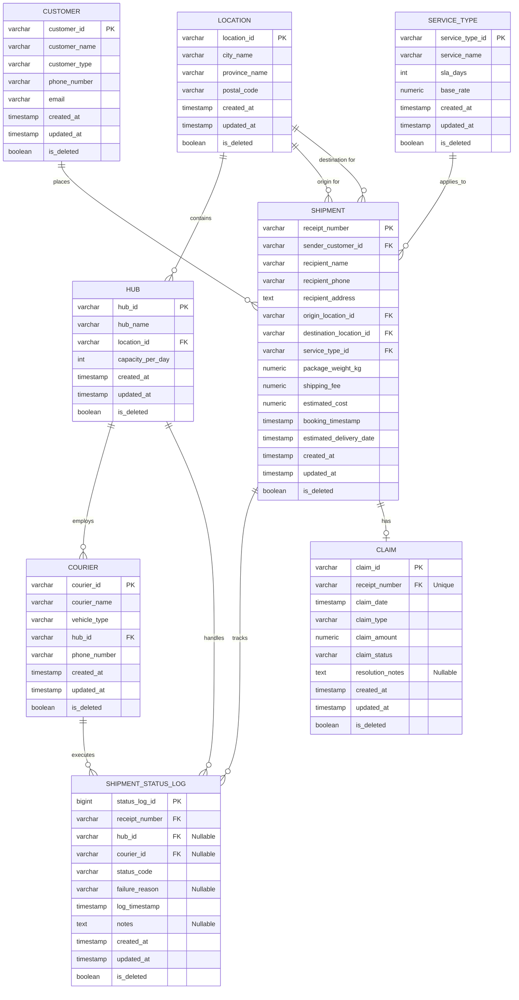

# Skema Database Operasional (OLTP) - Sistem Logistik & Pengiriman Barang

Dokumen ini mendefinisikan desain skema database transaksional (OLTP) harian untuk operasional ekspedisi logistik dengan menerapkan standar *best practice* database (*audit trails* dan *soft delete*: `created_at`, `updated_at`, `is_deleted`).

> Representasi skema dalam format DBML (lengkap dengan definisi tabel, relasi, dan sample records) tersedia di [oltp.dbml](oltp.dbml).

---

## 1. Entity Relationship Diagram (ERD)

---

## 2. Definisi Detail Kamus Data (Data Dictionary)

Setiap entitas mengadopsi tiga kolom standar audit dan siklus hidup data:
- `created_at` (TIMESTAMP): waktu saat record pertama kali dibuat.
- `updated_at` (TIMESTAMP): waktu terakhir record dimodifikasi.
- `is_deleted` (BOOLEAN): penanda *soft delete* (`true` = data dinonaktifkan/dihapus secara logis, `false` = aktif).

---

### A. Entitas `CUSTOMER`
Menyimpan profil pengirim barang (pelanggan individu maupun entitas bisnis).

| Nama Kolom | Tipe Data | Constraint | Deskripsi |
|---|---|---|---|
| `customer_id` | VARCHAR(32) | PRIMARY KEY | Kode unik pelanggan (misal: `CUST-001`) |
| `customer_name` | VARCHAR(150) | NOT NULL | Nama lengkap atau nama perusahaan |
| `customer_type` | VARCHAR(10) | NOT NULL | Klasifikasi pelanggan: `B2B` atau `B2C` |
| `phone_number` | VARCHAR(20) | NOT NULL | Nomor telepon pengirim |
| `email` | VARCHAR(100) | NULL | Alamat email pelanggan |
| `created_at` | TIMESTAMP | DEFAULT CURRENT_TIMESTAMP | Waktu pendaftaran pelanggan |
| `updated_at` | TIMESTAMP | DEFAULT CURRENT_TIMESTAMP | Waktu modifikasi terakhir |
| `is_deleted` | BOOLEAN | DEFAULT FALSE | Status soft delete |

---

### B. Entitas `LOCATION`
Menyimpan master data wilayah administratif (kota, provinsi, kode pos).

| Nama Kolom | Tipe Data | Constraint | Deskripsi |
|---|---|---|---|
| `location_id` | VARCHAR(32) | PRIMARY KEY | Kode wilayah unik (misal: `LOC-JKT-01`) |
| `city_name` | VARCHAR(100) | NOT NULL | Nama kota/kabupaten |
| `province_name` | VARCHAR(100) | NOT NULL | Nama provinsi |
| `postal_code` | VARCHAR(10) | NOT NULL | Kode pos wilayah |
| `created_at` | TIMESTAMP | DEFAULT CURRENT_TIMESTAMP | Waktu pembuatan master data |
| `updated_at` | TIMESTAMP | DEFAULT CURRENT_TIMESTAMP | Waktu modifikasi terakhir |
| `is_deleted` | BOOLEAN | DEFAULT FALSE | Status soft delete |

---

### C. Entitas `SERVICE_TYPE`
Katalog produk jasa pengiriman yang ditawarkan beserta target SLA dan tarif dasar.

| Nama Kolom | Tipe Data | Constraint | Deskripsi |
|---|---|---|---|
| `service_type_id` | VARCHAR(32) | PRIMARY KEY | Kode layanan (misal: `SRV-REG`, `SRV-EXP`) |
| `service_name` | VARCHAR(50) | NOT NULL | Nama produk jasa (`Reguler`, `Express`, `SameDay`) |
| `sla_days` | INT | NOT NULL | Target Service Level Agreement (hari) |
| `base_rate` | NUMERIC(12, 2) | NOT NULL | Tarif dasar per kg |
| `created_at` | TIMESTAMP | DEFAULT CURRENT_TIMESTAMP | Waktu produk dibuat |
| `updated_at` | TIMESTAMP | DEFAULT CURRENT_TIMESTAMP | Waktu pembaruan tarif/SLA |
| `is_deleted` | BOOLEAN | DEFAULT FALSE | Status soft delete |

---

### D. Entitas `HUB`
Pusat transit atau gudang penyortiran barang sebelum didistribusikan.

| Nama Kolom | Tipe Data | Constraint | Deskripsi |
|---|---|---|---|
| `hub_id` | VARCHAR(32) | PRIMARY KEY | Kode unik hub logistik (misal: `HUB-CGK-01`) |
| `hub_name` | VARCHAR(100) | NOT NULL | Nama hub / kantor cabang transit |
| `location_id` | VARCHAR(32) | FOREIGN KEY (`LOCATION`) | Lokasi administratif hub |
| `capacity_per_day` | INT | NOT NULL | Kapasitas throughput maksimal paket per hari |
| `created_at` | TIMESTAMP | DEFAULT CURRENT_TIMESTAMP | Waktu pendaftaran fasilitas hub |
| `updated_at` | TIMESTAMP | DEFAULT CURRENT_TIMESTAMP | Waktu update kapasitas/profil |
| `is_deleted` | BOOLEAN | DEFAULT FALSE | Status soft delete |

---

### E. Entitas `COURIER`
Master armada/kurir lapangan yang bertugas mengantar atau menjemput paket.

| Nama Kolom | Tipe Data | Constraint | Deskripsi |
|---|---|---|---|
| `courier_id` | VARCHAR(32) | PRIMARY KEY | ID unik kurir (misal: `CR-001`) |
| `courier_name` | VARCHAR(150) | NOT NULL | Nama personil kurir |
| `vehicle_type` | VARCHAR(30) | NOT NULL | Jenis armada (`Motorcycle`, `Van`, `Truck`) |
| `hub_id` | VARCHAR(32) | FOREIGN KEY (`HUB`) | Hub pangkalan penugasan kurir |
| `phone_number` | VARCHAR(20) | NOT NULL | Nomor kontak kurir |
| `created_at` | TIMESTAMP | DEFAULT CURRENT_TIMESTAMP | Waktu kurir didaftarkan |
| `updated_at` | TIMESTAMP | DEFAULT CURRENT_TIMESTAMP | Waktu update armada/kontak |
| `is_deleted` | BOOLEAN | DEFAULT FALSE | Status soft delete (misal jika non-aktif) |

---

### F. Entitas `SHIPMENT`
Tabel transaksi utama pembuatan order pengiriman (resi).

| Nama Kolom | Tipe Data | Constraint | Deskripsi |
|---|---|---|---|
| `receipt_number` | VARCHAR(50) | PRIMARY KEY | Nomor resi/surat muatan udara (AWB) |
| `sender_customer_id` | VARCHAR(32) | FOREIGN KEY (`CUSTOMER`) | ID pengirim barang |
| `recipient_name` | VARCHAR(150) | NOT NULL | Nama penerima paket |
| `recipient_phone` | VARCHAR(20) | NOT NULL | Nomor kontak penerima paket |
| `recipient_address` | TEXT | NOT NULL | Alamat jalan detail tujuan paket |
| `origin_location_id` | VARCHAR(32) | FOREIGN KEY (`LOCATION`) | Lokasi kota asal kirim |
| `destination_location_id` | VARCHAR(32) | FOREIGN KEY (`LOCATION`) | Lokasi kota tujuan kirim |
| `service_type_id` | VARCHAR(32) | FOREIGN KEY (`SERVICE_TYPE`) | ID jenis layanan yang dipilih |
| `package_weight_kg` | NUMERIC(8, 2) | NOT NULL | Berat aktual/volumetrik paket (KG) |
| `shipping_fee` | NUMERIC(12, 2) | NOT NULL | Pendapatan ongkos kirim ditagihkan |
| `estimated_cost` | NUMERIC(12, 2) | NOT NULL | Estimasi biaya operasional internal |
| `booking_timestamp` | TIMESTAMP | NOT NULL | Waktu pemesanan / resi diterbitkan |
| `estimated_delivery_date` | TIMESTAMP | NOT NULL | Batas waktu SLA (`booking_timestamp + sla_days`) |
| `created_at` | TIMESTAMP | DEFAULT CURRENT_TIMESTAMP | Waktu record masuk ke sistem |
| `updated_at` | TIMESTAMP | DEFAULT CURRENT_TIMESTAMP | Waktu modifikasi status order |
| `is_deleted` | BOOLEAN | DEFAULT FALSE | Status pembatalan/soft delete resi |

---

### G. Entitas `SHIPMENT_STATUS_LOG`
Tabel audit trail riwayat perjalanan paket (*tracking history*).

| Nama Kolom | Tipe Data | Constraint | Deskripsi |
|---|---|---|---|
| `status_log_id` | BIGINT GENERATED | PRIMARY KEY | Auto-increment identifier log |
| `receipt_number` | VARCHAR(50) | FOREIGN KEY (`SHIPMENT`) | Nomor resi terkait |
| `hub_id` | VARCHAR(32) | FOREIGN KEY (`HUB`), NULL | Hub tempat event terjadi (jika ada) |
| `courier_id` | VARCHAR(32) | FOREIGN KEY (`COURIER`), NULL | Kurir yang memproses event (jika ada) |
| `status_code` | VARCHAR(30) | NOT NULL | Status: `PICKUP`, `IN_TRANSIT`, `OUT_FOR_DELIVERY`, `DELIVERED`, `FAILED`, `RETURNED` |
| `failure_reason` | VARCHAR(100) | NULL | Keterangan jika `FAILED` (`Rumah Kosong`, dll) |
| `log_timestamp` | TIMESTAMP | DEFAULT CURRENT_TIMESTAMP | Waktu pencatatan status di scanner/aplikasi |
| `notes` | TEXT | NULL | Catatan lapangan kurir/operator |
| `created_at` | TIMESTAMP | DEFAULT CURRENT_TIMESTAMP | Waktu event direkam ke database |
| `updated_at` | TIMESTAMP | DEFAULT CURRENT_TIMESTAMP | Waktu perubahan (jika ada koreksi log) |
| `is_deleted` | BOOLEAN | DEFAULT FALSE | Status soft delete |

---

### H. Entitas `CLAIM`
Tabel operasional klaim asuransi / ganti rugi barang bermasalah.

| Nama Kolom | Tipe Data | Constraint | Deskripsi |
|---|---|---|---|
| `claim_id` | VARCHAR(32) | PRIMARY KEY | Kode tiket klaim (misal: `CLM-2026-001`) |
| `receipt_number` | VARCHAR(50) | FOREIGN KEY (`SHIPMENT`), UNIQUE | Satu resi hanya memiliki maksimal 1 entri klaim aktif |
| `claim_date` | TIMESTAMP | NOT NULL | Waktu pengajuan komplain oleh pelanggan |
| `claim_type` | VARCHAR(20) | NOT NULL | Kategori klaim: `DAMAGED` atau `LOST` |
| `claim_amount` | NUMERIC(12, 2) | NOT NULL | Nilai ganti rugi yang diajukan/disetujui |
| `claim_status` | VARCHAR(20) | NOT NULL | Status tiket: `SUBMITTED`, `INVESTIGATING`, `APPROVED`, `REJECTED` |
| `resolution_notes` | TEXT | NULL | Hasil investigasi dan keputusan Finance |
| `created_at` | TIMESTAMP | DEFAULT CURRENT_TIMESTAMP | Waktu pengajuan tiket |
| `updated_at` | TIMESTAMP | DEFAULT CURRENT_TIMESTAMP | Waktu perubahan status tiket klaim |
| `is_deleted` | BOOLEAN | DEFAULT FALSE | Status pembatalan pengajuan klaim |
